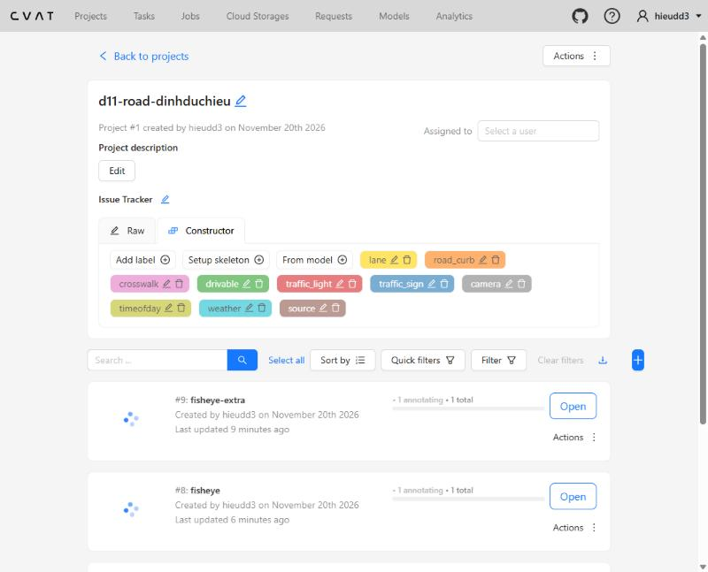
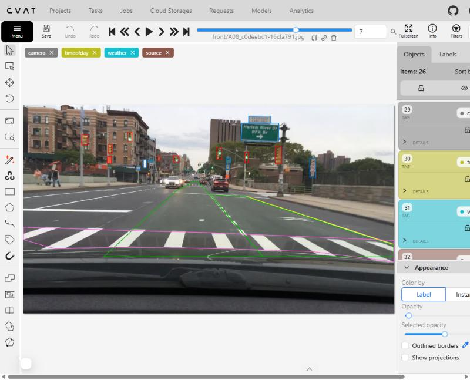
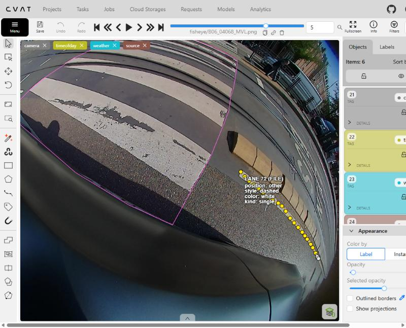

# Báo cáo cá nhân — Ngày 11
Họ tên: Đinh Đức Hiếu               Mã học viên: 2A202603327  
Phiên bản CVAT (Help → About): 2.81.0  
Guideline: Road v1.0    Lần nộp (`revision` trong manifest): 2 (bản revision 1 giữ trong thư mục `r1/`)  
Thời điểm export (ngày giờ trên CVAT): 21/11/2026 10:36 giờ Việt Nam (21/11/2026 03:36 UTC; kiểm lại ở trang Requests của CVAT)    Số lần nộp lại sau Rework: 1  

## 1. Kiểm project
| Mục | Đúng như guideline Road v1.0? | Ghi chú |
| --- | --- | --- |
| 6 label, đúng kiểu | Có | lane, road_curb (polyline); crosswalk, drivable (polygon); traffic_light, traffic_sign (rectangle). Dán từ `configs/road_v1_labels.json` vào tab Raw |
| Thuộc tính và giá trị | Có | Đối chiếu từng giá trị với `python -m road_lab.taxonomy` |
| 4 tag ảnh | Có | camera, timeofday, weather, source; mỗi tag một thuộc tính select `value` |

Cách kết thúc polyline trên bản CVAT này: nhấn phím **N** (hoặc bấm lại nút Shape).  
Cách đặt tag ảnh trên bản CVAT này: công cụ Tag ở thanh bên trái → chọn label → mở Details trong bảng Objects để sửa `value` (CVAT tự điền giá trị đầu danh sách).

## 2. Số lượng đã gán
| Task | Ảnh | lane | road_curb | crosswalk | drivable | traffic_light | traffic_sign |
| --- | ---: | ---: | ---: | ---: | ---: | ---: | ---: |
| front | 12 | 30 | 6 | 4 | 28 | 31 | 39 |
| front-extra (đã làm 4 / 4) | 4 | 10 | 1 | 2 | 7 | 12 | 16 |
| fisheye | 8 | 5 | 10 | 8 | 10 | 7 | 10 |
| fisheye-extra (đã làm 4 / 4) | 4 | 1 | 4 | 4 | 4 | 0 | 0 |

## 3. Bảng ca khó
| Ảnh | Nhãn | Phân vân giữa | Đã chọn | Lý do |
| --- | --- | --- | --- | --- |
| A05 | lane L1/R1 | vẽ L1/R1 hay để trống | để trống | Đường không có vạch sơn, chỉ có lề hai bên; lint báo QC1-02, cần coach xác nhận miễn |
| A07 | lane L1 | có vạch trắng sát dải phân cách hay không | vẽ L1 solid white (sau Rework) | Lần đầu không chắc nên để trống; phiếu QC chỉ ra có vạch, phóng to ảnh gốc thấy rõ vạch trắng liền sát chân dải bê tông nên đã vẽ |
| A08 | lane L1 | vạch đứt mờ bên trái làn có thật hay không | vẽ L1 dashed white | Tăng tương phản thấy rõ các vệt đứt bên trái làn; vẽ L1 trên tâm vệt và kéo mép trái drivable direct theo L1 |
| A09 | lane R1 | vệt đứt mờ bên phải làn | chưa vẽ | Vệt mờ, có thể là vết bánh xe; hỏi coach |
| A12 | lane position | xe đang ở làn trái hay làn phải | giữ L1/R1 theo vạch sau vạch ngựa vằn | Xe ở giữa ngã tư, gần như đè lên vạch đứt |
| B03, B04 | lane R1/L1 (camera sau) | đặt tên theo phía trên ảnh hay theo phía của xe | theo phía trên ảnh | Camera sau nhìn ngược chiều xe chạy; guideline chỉ ghi "tính theo làn đang đi"; hỏi lead |
| B04 | drivable alternative | làn BUS có tính là làn cùng chiều bên cạnh không | alternative | Cùng chiều, nhưng làn bus không dành cho xe thường; hỏi lead |
| B06 | drivable | có gồm làn tàu điện (ray) hay không | gán drivable direct (sau Rework) | Bản đầu bị xóa mất drivable; phiếu QC ghi thiếu, đã vẽ lại từ mép thân xe tới vạch làn phía xa. Phần ray tàu điện vẫn hỏi coach |
| B11 | lane | vạch ô đỗ / vạch vàng có gán lane không | không gán lane | Guideline mục 4: vạch ô đỗ không gán lane; không thấy vạch dọc thật |

## 4. Phiếu QC 1 nhận được
Bạn kiểm lô của tôi: nguyenhoainam  Quyết định nhận được: **Rework** (1 lỗi nặng; lỗi chính 3/69 = 4,3 %)  
| Mã lỗi | Số lỗi | Đồng ý? | Đã sửa? |
| --- | ---: | --- | --- |
| QC1-02 (A07 thiếu L1) | 1 | Đồng ý: phóng to thấy vạch trắng liền sát dải bê tông | Đã sửa: thêm L1 solid white trên tâm vạch |
| QC1-07 (A07 drivable dừng ở đuôi xe trước) | 1 | Đồng ý: guideline yêu cầu "đi được nếu đường trống" | Đã sửa: kéo direct qua xe tới cuối làn, nằm giữa L1 và R1 |
| QC1-07 (B06 không có drivable) | 1 | Đồng ý: trọng tâm ảnh là drivable | Đã sửa: vẽ lại drivable direct, mép dưới bám thân xe |
| QC1-09 (B04 đèn đi bộ gán vehicle) | 1 | Đồng ý: đèn hình người | Đã sửa: `type = pedestrian` |

Ca mơ hồ trong phiếu (làn BUS ở B04; miễn QC1-02 ở A05, A09) đã hỏi coach.  
Nộp lại: export lại lúc 21/11/2026 10:36, giữ nguyên tên `dinhduchieu-front.zip`, `dinhduchieu-fisheye.zip`, manifest mới `--revision 2`; bản revision 1 (2 zip + `dinhduchieu-manifest-r1.json`) giữ trong thư mục `r1/`. Sau khi sửa, `lint` còn 3 cảnh báo QC1-02 ở A05 (L1, R1) và A09 (R1), là ảnh không thấy vạch.

## 5. Kiểm file export
| File | Mở lại được? | Số shape ảnh 1 (job / file) | Số shape ảnh 2 (job / file) | Tag camera có trong XML? |
| --- | --- | --- | --- | --- |
| dinhduchieu-front.zip | Có (`road_check lint`: 28 ảnh đọc được) | A01: 9 / 9 | A02: 6 / 6 | Có (`camera=front`) |
| dinhduchieu-fisheye.zip | Có | B01: 4 / 4 | B02: 8 / 8 | Có (`camera=fisheye_front`) |

`lint` còn 3 cảnh báo, đều là QC1-02 ở A05 (L1, R1) và A09 (R1); chờ coach xác nhận miễn (xem bảng ca khó). Manifest: `contains_images = false` cho cả hai file, 16 + 12 ảnh, mọi ảnh đủ bốn tag.

## 6. Ảnh chụp màn hình
1. Tab Labels của project:

   

2. Một ảnh camera trước đã gán đủ (A08: làn, vùng lái, vạch ngựa vằn, đèn và biển):

   

3. Một ảnh fisheye đã gán, phóng to đoạn polyline cong (B06, lane `position = other`):

   

4. Một đoạn XML có `<polyline label="lane">`, ví dụ trong `dinhduchieu-front.zip`:

```xml
<polyline label="lane" source="manual" occluded="0" points="655.00,682.00;630.00,660.00;600.00,640.00;586.00,630.00;528.00,590.00;513.00,580.00;483.00,560.00;463.00,545.00;448.00,535.00;432.20,524.60" z_order="0">
  <attribute name="position">R1</attribute>
  <attribute name="style">dashed</attribute>
  <attribute name="color">white</attribute>
  <attribute name="kind">single</attribute>
</polyline>
```

## 7. Tự đánh giá
Lỗi bạn mắc nhiều nhất hôm nay (theo mã QC1-xx), và cách tránh ở Ngày 20:  
- **QC1-05**: vẽ vạch đôi thành hai polyline (A04, A09, A11, A14). Cách tránh: vạch đôi luôn là **một** polyline ở giữa hai nét, `kind = double`.  
- **QC1-03 / QC1-02**: gán vạch vàng đôi sát làn mình là L2 thay vì L1 (A11, A14). Cách tránh: trước khi gán position, xác định hai vạch sát xe nhất trước, đó luôn là L1/R1.  
- **QC1-04**: vẽ từ xa về gần (A02, A04). Cách tránh: luôn đặt điểm đầu sát capô; tự kiểm bằng `lint`.  
- **QC1-11**: polyline fisheye quá ít điểm, không theo cung. Cách tránh: phóng to, đặt điểm khoảng mỗi 20–30 px, dày ở vòng ngoài.

Nhãn của bạn đi vào model ở đâu? Chọn một lỗi đã sửa và nói nó làm model học sai thế nào:  
Polyline làn được đổi thành đích row-anchor cho model phát hiện làn (mỗi hàng ảnh một toạ độ x cho mỗi vạch). Ở A11, vạch vàng đôi sát làn mình bị gán L2 nên L1 bị coi là "không có". Model sẽ học rằng làn mình không có vạch trái, trong khi thực tế bên trái là vạch tim đường ngăn hai chiều; hệ thống giữ làn (LKA) có thể cho xe lấn sang làn ngược chiều. Sau khi sửa, vạch đôi là một polyline L1 nên đích của hàng ảnh đó đúng vị trí tim đường.

_Ghi chú minh bạch: tôi dùng trợ lý AI (Claude Code) để soát lỗi theo guideline, chỉnh lane fisheye về tâm vệt sơn, gộp vạch đôi, export và tạo manifest. Bản gốc trước khi AI chỉnh được lưu ở `out/cvat_backup_before_edit.json`._

## 8. (Tùy chọn, buffer) Từ polyline đến đích row-anchor
Ảnh A01, vạch R1 (`python -m road_lab.rowanchor dinhduchieu-front.zip --image A01 --position R1`):

| y | 720 | 680 | 640 | 600 | 560 |
| --- | ---: | ---: | ---: | ---: | ---: |
| x của chúng tôi | không có làn | 652.7 | 600.0 | 542.5 | 483.0 |
| x của bạn kia (nguyenhoainam) | không có làn | 662.8 | 603.0 | 544.6 | 486.4 |

Trả lời 3 câu:

1. Polyline R1 của tôi dừng ở y ≈ 525. Nếu dừng sớm 40 px (y ≈ 565) thì hàng **560** đổi thành "không có làn". Hàng 720 đã là "không có làn" vì điểm đầu nằm ở y = 682, sát capô.
2. Hàng 720: cả hai đều "không có làn" (cả hai polyline bắt đầu ở y ≈ 682 và 719, chưa chạm hàng 720 hoặc chỉ sát mép), nên không so được; hàng 680 lệch 10,1 px; hàng 560 lệch 3,4 px. Lệch ở hàng gần xe (720, 680) (gần xe) ảnh hưởng LKA nhiều hơn, vì giữ làn dựa chủ yếu vào vị trí vạch ngay trước xe.
3. Cách tính không đổi: script nội suy giữa hai điểm kẹp mỗi hàng nên không phụ thuộc thứ tự điểm. Nhưng các script coi điểm đầu là điểm gần xe sẽ gặp khó: `road_check lint` báo QC1-04 "điểm đầu cao hơn điểm cuối", còn phần kiểm hai đầu polyline của `road_check check` (ngưỡng `lane_stop_px`) sẽ so nhầm đầu gần với đầu xa.
